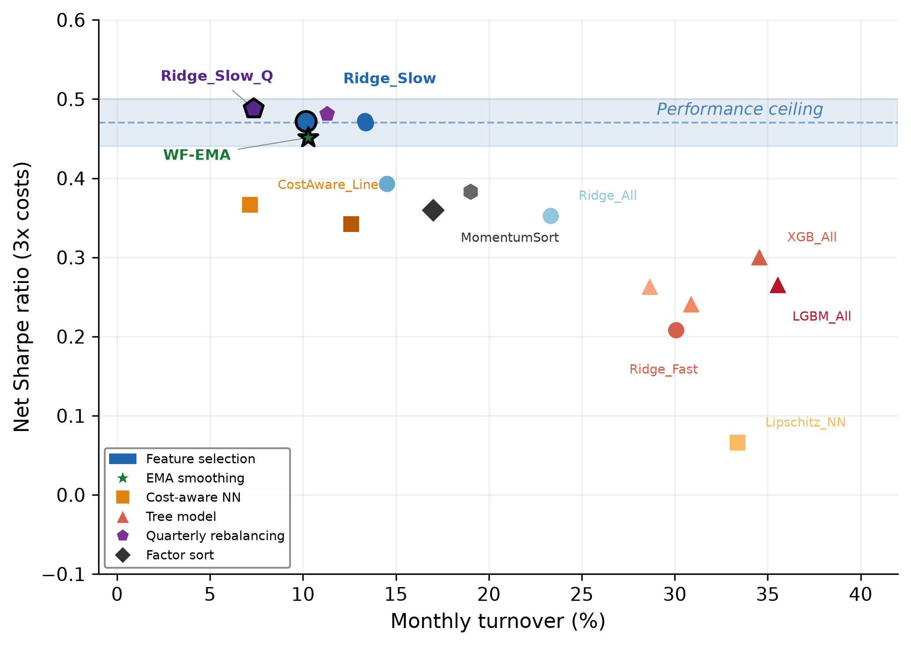
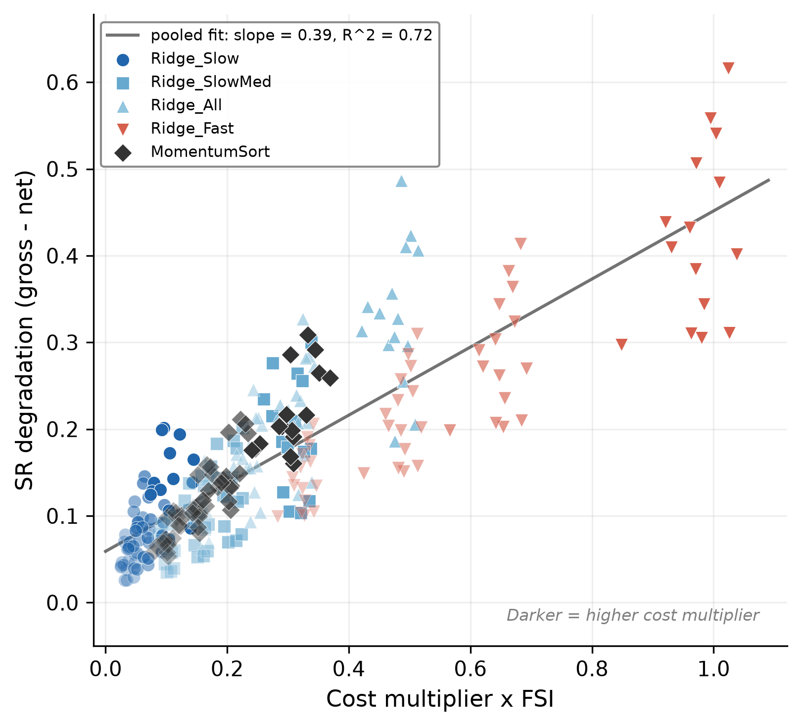
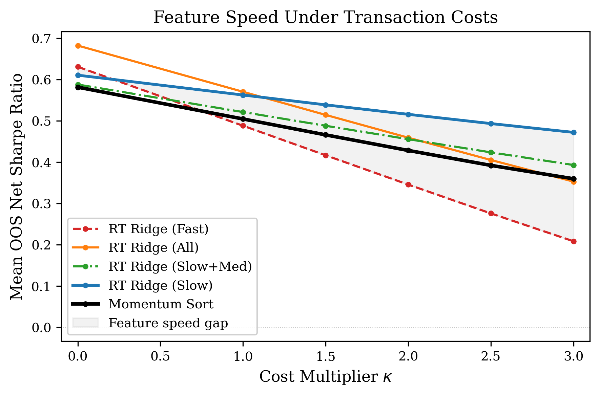
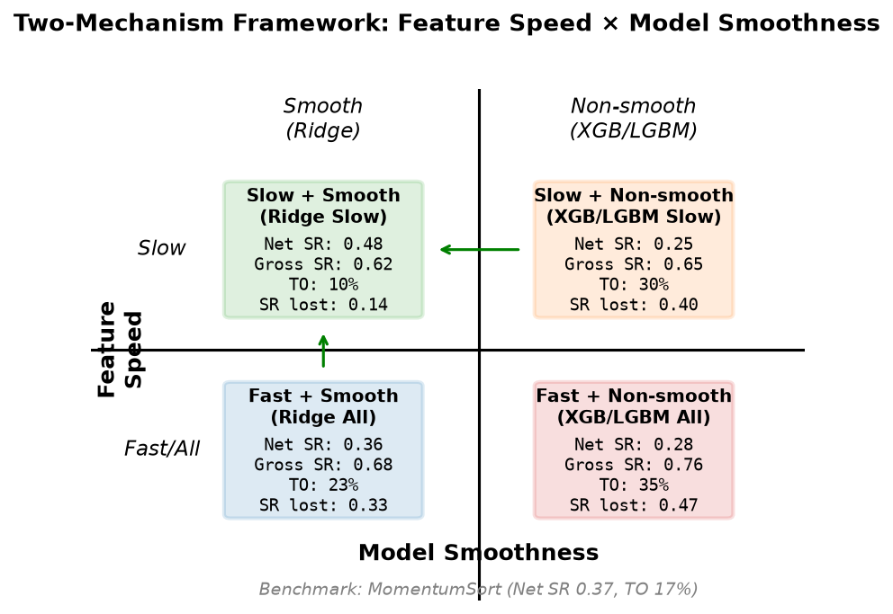

# Feature Speed, Transaction Costs, and the Limits of Machine Learning in Emerging Markets

[](paper_icaifv2/main_v6_frontier.pdf)
[](https://ai-finance.org)
[](paper_icaifv2/public/results/verification_report.md)
[](LICENSE)
[](requirements.txt)

Code and verified results for the paper *"Feature Speed, Transaction Costs,
and the Limits of Machine Learning in Emerging Markets"* (under review).

Across 15 emerging markets, eight intervention variants spanning four
mechanism families converge on
the same net Sharpe ceiling (~0.45–0.49 at 3x transaction costs). The ceiling
is traced by a cost-speed frontier: SR degradation ≈ λ·κ·FSI + c, where the
Feature Speed Index (FSI) measures a strategy's ex-ante exposure to
fast-moving characteristics. FSI explains 64–65% of cross-sectional SR
degradation at each fixed cost level (λ ≈ 0.33 per unit κ; pooled R² = 0.72
across 300 strategy–market–cost combinations) and predicts realized turnover
before any trading occurs (R² = 0.73).

<p align="center">
  
</p>

## Results at a glance

| | |
|---|---|
|  |  |
| **The frontier**: SR degradation vs κ·FSI across 300 strategy–market–cost combinations (pooled R² = 0.72; cross-sectional R² = 0.64–0.65 at each κ). | **The interaction**: fast features are competitive gross, but degrade ~3× faster as costs rise. |

<p align="center">
  
</p>

## Repository layout

```
paper_icaifv2/
  main_v6_frontier.tex        Paper source (ACM sigconf, anonymized)
  figures/                    Publication figures (PDF)
  public/
    MANIFEST.json             Canonical experiment scripts, outputs, caveats
    scripts/
      verify_paper_claims.py  Recomputes every table-level claim from the CSVs
      run_canonical_experiments.py
      build_paper_tables.py
    results/                  Generated verification report and claim JSON
public/src/                   Core library (data loading, backtesting, portfolio, costs)
scripts/concern_experiments/  Experiment scripts and their canonical CSV outputs
```

## Verifying the paper's claims

Every number in the paper's tables is pinned to a canonical CSV in this
repository. To recompute and check them all:

```bash
python3 paper_icaifv2/public/scripts/verify_paper_claims.py --write-report --write-json
```

This runs 99 checks (numeric claims plus leakage/provenance guardrails on the
experiment source code) and exits non-zero if any blocking check fails. The
generated report lands in `paper_icaifv2/public/results/`.

Requires only `python3` with `numpy`/`pandas`/`scipy` for the verifier
(`pip install -r requirements.txt`).

## Reproducing the experiments

The canonical experiment pipeline is listed in
`paper_icaifv2/public/MANIFEST.json`. To see the commands without running:

```bash
python3 paper_icaifv2/public/scripts/run_canonical_experiments.py
```

Full retraining (walk-forward, 15 markets, all models) takes several hours per
experiment and requires the input data (see below):

```bash
python3 paper_icaifv2/public/scripts/run_canonical_experiments.py --run --verify
```

### Data availability

The firm-level characteristic data come from the **JKP Global Factor Data**
(Jensen, Kelly, and Pedersen, 2023; https://jkpfactors.com), which we cannot
redistribute. Place per-market CSVs at `data/<MKT>EquitiesData.csv`
(monthly, `eom`/`gvkey`/`ret_1_0` plus ~154 characteristics; Thailand at
`public/data/ThaiEquitiesData.csv`) and the US file at `data/USEquityGFD.csv`,
as listed in `scripts/concern_experiments/market_config.py`. All canonical
result CSVs are included, so the
verification layer works without any raw data.

## Key correctness conventions

These are enforced by the verifier's source guardrails:

1. **Lag before filter** — features are lagged one month *before* the top-N
   market-cap universe filter (avoids collider bias via
   `me(T) = me(T-1) × (1+r)`).
2. **Market cap is excluded** from the predictor set (it is the universe
   filter) and lagged one month before filtering.
3. **All features use lag=1** on top of the 4-month accounting lag already
   applied inside the JKP data.
4. **Walk-forward everything** — expanding window (min 60 months), monthly
   retraining, preprocessing and feature selection fit on training data only.
5. **Rank targets** — all ML models train on cross-sectional percentile ranks.
6. **Costs** — Corwin-Schultz half-spread × κ, clipped to [20, 200] bps;
   baseline κ = 3 for EM.

## License

MIT (code). The included result CSVs are derived outputs; the underlying JKP
data are subject to their own terms.
